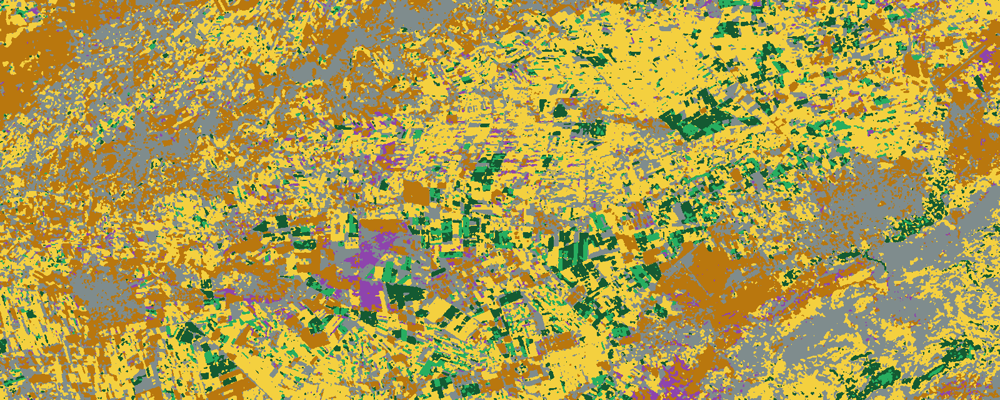

# Crop mapping and economic valuation of the Tadla irrigated perimeter (Morocco)

Sentinel-2 time series, Random Forest classification and a transparent gross-revenue estimate for the 2024-2025 season, built with Google Earth Engine and Python.

*Crop map of the study area (about 42 x 20 km). Yellow: cereals, green: alfalfa, dark green: tree crops, purple: market gardening, brown: bare soil, grey: built-up / other.*

## What this project does

1. Builds 12 monthly NDVI composites from Sentinel-2 L2A (cloud and shadow masking with the SCL band).
2. Classifies land use with a Random Forest trained on visually interpreted points.
3. Computes the area of each class.
4. Converts areas into gross revenue under three scenarios (low, central, high), with every yield and price traced to a source.

## Results

Areas come from the smoothed map at 30 m resolution. Treat them as orders of magnitude.

| Class | Area (ha) |
|---|---|
| Cereals | 31,005 |
| Alfalfa | 3,033 |
| Tree crops | 6,057 |
| Market gardening (low reliability) | 2,081 |
| Bare soil | 17,018 |
| Built-up / other | 25,367 |

Gross revenue, in million Dh (scenarios: low / central / high):

| Class | Low | Central | High |
|---|---|---|---|
| Cereals | 303.8 | 347.3 | 382.0 |
| Tree crops (olive proxy) | 53.3 | 96.9 | 141.7 |

Alfalfa and market gardening are not valued yet because no reliable yield and price source was found. See `data/parametres_economiques.csv` for parameters and sources.

## Method

- **Study area:** bounding box `[-6.75, 32.25, -6.30, 32.43]` (WGS84), Tadla irrigated perimeter and its eastern edge.
- **Imagery:** Sentinel-2 L2A (`COPERNICUS/S2_SR_HARMONIZED`), September 2024 to August 2025, monthly median NDVI.
- **Training data:** points interpreted visually from high-resolution imagery and NDVI profiles (not field data), stored in `data/train_points_v2.geojson`.
- **Model:** Random Forest (300 trees) on the 12 monthly NDVI values, followed by a 3x3 majority filter.
- **Valuation:** area x yield x price, no production costs.

## Validation

Stratified 5-fold cross-validation on the training points.

- Overall accuracy: 0.58 (5-fold cross-validation, 119 points). Best classes: tree crops (F1 0.81) and alfalfa (F1 0.71); weakest: market gardening (F1 0.18).
- Main confusions: market gardening is mostly mistaken for alfalfa and cereals, cereals for bare soil, and bare soil for built-up / other, which share a similar NDVI signature.

The estimate is noisy and probably optimistic: there are few points and they are spatially clustered. A first version with four classes had a cross-validated accuracy of about 0.69 (not directly comparable: fewer and easier classes).

## Limitations

- Labels come from visual interpretation, not field data.
- Market gardening is the least reliable class (F1 0.18): its area should not be used for decisions.
- Sugar beet is not modelled and is probably absorbed by other classes, mostly cereals.
- Natural steppe and rangeland have no class and end up in "bare soil" or "built-up / other", so these two classes are overestimated.
- Tree crops mix olive and citrus but are valued as olive.
- The estimate is gross revenue, not margin. Alfalfa and market gardening are not valued.
- Yields are reference values from reports and press, not estimated from imagery.

## Reproduce

1. Open `crop_mapping_tadla.ipynb` in Google Colab.
2. Register a Google Cloud project for Earth Engine and set `GCP_PROJECT` in the setup cell.
3. Run all cells. Figures and tables are written to `results/`.

Local install: `pip install -r requirements.txt`.

## Data and sources

- Sentinel-2 L2A, Copernicus programme, accessed through Google Earth Engine.
- Soft wheat reference price: ONICL marketing scheme, 2026 campaign (reported by Medias24 and Le360).
- Olive price and yield: press reports (Bladi, Le Matin, Aujourd'hui le Maroc) citing ORMVAT figures.
- Irrigated cereal yields: La Vie eco; ORMVA Haouz presentation (FAO workshop, 2017).

Full details are in `data/parametres_economiques.csv`.

## Next steps

- Add field data or an official crop plan to improve the labels and add sugar beet.
- Add a "natural vegetation / rangeland" class.
- Add production costs to compute margins.
- Use spatial cross-validation and more indices (EVI, NDWI, SWIR).
